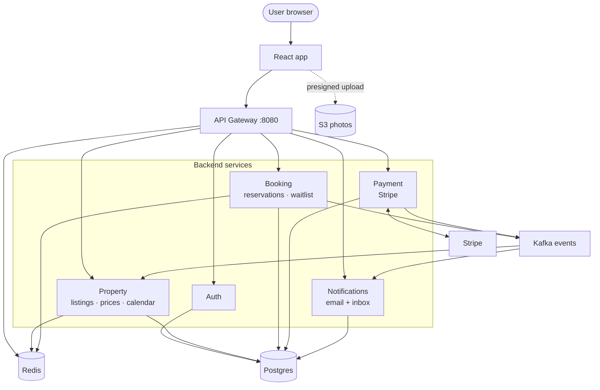
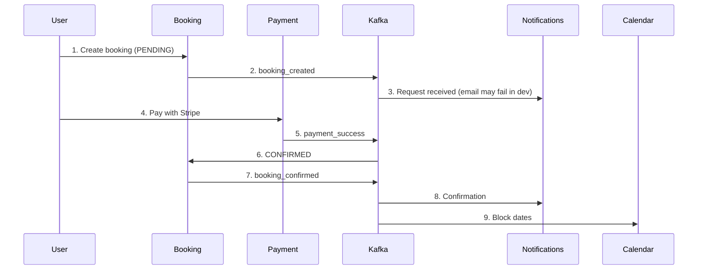

# StaySphere

Microservices property-booking platform (Airbnb-style): JWT auth, Postgres search, concurrency-safe bookings, Stripe payments, Kafka events, S3 listing media, and a React web UI.

**Table of contents:** [Quick start](#quick-start) · [Architecture](#architecture) · [Development](#development) · [Operations](#operations) · [Integrations](#integrations) · [Tech stack](#tech-stack) · [Scripts](#scripts) · [Repository layout](#repository-layout)

---

## Quick start

**Prerequisites:** JDK 21+, Docker Desktop (Compose v2), Node.js 20+

```bash
git clone https://github.com/sachin3059/stay-sphere.git
cd stay-sphere
cp env.template .env    # set JWT_SECRET (32+ chars) and integrations as needed
```

| Command | Purpose |
|---------|---------|
| `.\scripts\start-backend.ps1` (Windows) | Build JARs + `docker compose up` |
| `./scripts/start-backend.sh` (Unix) | Same on Linux/macOS/Git Bash |
| `cd frontend && npm ci && npm run dev` | React dev server |

Optional: `cd frontend && cp .env.example .env` for OAuth / maps keys (`VITE_*`). Backend secrets stay in repo-root `.env`.

| URL | What |
|-----|------|
| http://localhost:5173 | React (Vite dev) |
| http://localhost:8080 | API gateway |
| http://localhost | Full stack (`web` + nginx `/api` proxy) |

Set `CORS_ALLOWED_ORIGINS=http://localhost:5173` in `.env` and restart **api-gateway** if the browser blocks API calls.

**Smoke test:**

```bash
curl http://localhost:8080/api/auth/health
curl http://localhost:8080/api/properties/health
curl http://localhost:8080/api/bookings/health
curl http://localhost:8080/api/payments/health
```

Frontend UI notes and route-level build order: [frontend/README.md](frontend/README.md).

---

## Architecture

StaySphere splits the backend into **small services**. The **website** uses one entry point (**API gateway**). Services persist in **Postgres**, coordinate async work via **Kafka**, and use **Redis** for cache, locks, and logout denylist.

### Three ideas

1. **One front door** — Browser calls the gateway (`:8080`). It validates JWT and routes by path.
2. **Each service owns its tables** — Booking needs a price? **HTTP** to property-service. Payment succeeded? Booking listens on **Kafka**.
3. **No global DB transaction** — **Transactional outbox + Kafka** plus **idempotency** (choreography, not 2PC).

### System diagram

Read top → bottom: **browser → gateway → services → storage**. Dashed lines are outside the cluster.



| Layer | What happens |
|-------|----------------|
| Top | React; API traffic goes through the gateway only. |
| Services | Auth, property, booking, payment, notification — routed by URL. |
| Postgres | One DB in dev (`staysphere`); each service has its own Flyway tables. |
| Redis | Search cache, booking lock, gateway rate limits, JWT denylist. |
| Kafka | Booking & payment **publish**; notifications & property **subscribe**. |
| Dashed | Photos: browser → S3. Charges: payment ↔ Stripe. |

**Local ports:** gateway `8080`, auth `8081`, property `8082`, booking `8083`, payment `8084`, notification `8087`.

### Services

| Service | Role |
|---------|------|
| **Gateway** | `/api/...`, rate limit, JWT, CORS |
| **Auth** | Register, login, JWT, Google/GitHub, admin users |
| **Property** | Listings, search, pricing, availability, S3 presign |
| **Booking** | Reservations, overlap guards, waitlist |
| **Payment** | Stripe PaymentIntents, refunds, outbox → Kafka |
| **Notification** | In-app inbox + email (SES) from Kafka |

Property exposes `/api/properties`, `/api/pricing`, `/api/availability` in one app. Booking includes waitlist in the same app.

### Book and pay (happy path)



Statuses: `PENDING` → `CONFIRMED` or `CANCELLED` / `EXPIRED`. Backup: `POST /api/bookings/{id}/confirm` if Kafka is slow.

### Outbox

On payment success (payment-service), one transaction: update `payments`, insert `payment_outbox_events`. A job (~every 2s) publishes to Kafka. Consumers use `processed_events` so retries do not double-confirm.

### Double booking

1. Short **Redis lock** while creating a booking.  
2. SQL overlap check.  
3. **Postgres exclusion** — two confirmed stays cannot overlap the same property/dates.  
4. **`Idempotency-Key`** on create booking.

### Kafka topics

| Topic | Publisher | Consumers | Purpose |
|-------|-----------|-----------|---------|
| `booking-events` | Booking | Notifications, property | Created / confirmed / cancelled |
| `payment-events` | Payment | Booking, notifications | Pay success / fail / refund |
| `waitlist-events` | Booking | Notifications | Waitlist slot offered |

### Security

- `Authorization: Bearer <JWT>` on protected routes.  
- Roles: **GUEST**, **HOST**, **ADMIN**; hosts only edit listings where `hostId` matches the token.  
- Logout adds the access token to a **Redis denylist**.

### Extras

- **Search** — Postgres full-text; Redis cache-aside.  
- **Unlisted listing** — hidden from Explore; host edit via `GET /api/properties/host/{id}`.  
- **Not 2PC** — choreography; future **reconciliation** job can compare Stripe vs DB if needed.

Preview Mermaid on GitHub or VS Code, or use [Mermaid Live](https://mermaid.live).

---

## Development

### Environment

Single source of truth: **repo-root `.env`** (copy `env.template`; never commit). Docker loads it via `env_file`; Spring `local` profile can import `../.env`.

Minimum for local smoke test: `JWT_SECRET` (32+ characters), `POSTGRES_*` (defaults match Compose), Stripe test keys if testing pay (`PAYMENT_GATEWAY=stripe`). Full variable list: `env.template`.

### Run infrastructure only (IDE)

```bash
docker compose up -d postgres redis zookeeper kafka
```

From `backend/`:

```bash
./gradlew :auth-service:bootRun
./gradlew :property-service:bootRun
./gradlew :booking-service:bootRun
./gradlew :payment-service:bootRun
./gradlew :notification-service:bootRun
./gradlew :api-gateway:bootRun
```

On the host use `SPRING_DATASOURCE_URL=jdbc:postgresql://localhost:5433/staysphere` (see `env.template`).

### Reset local data (optional)

```powershell
.\scripts\reset-local-data.ps1
```

Truncates app tables (keeps Flyway history), flushes Redis, recreates Kafka topics, restarts services. Does **not** delete S3 objects.

### Manual E2E checklist

1. Register → optional **Become host**  
2. Create listing, pricing, [S3 photos](#amazon-s3-listing-media)  
3. Publish listing (`ACTIVE`)  
4. Book as guest with dates  
5. Pay with Stripe test card `4242 4242 4242 4242`  
6. Trip **CONFIRMED**; host calendar blocked; `GET /api/notifications/my`

### Logs

```bash
docker compose logs -f api-gateway property-service booking-service payment-service notification-service
docker logs staysphere-booking --tail 100
```

Periodic SQL on `*_outbox_events` every ~2s is normal (outbox publishers).

### Tests and CI

```bash
cd backend && ./gradlew build
cd frontend && npm run build
```

GitHub Actions (`.github/workflows/ci.yml`) runs both on push/PR to `main`.

---

## Operations

### Run modes

| Mode | Frontend | API | Notes |
|------|----------|-----|--------|
| **Dev** | `npm run dev` :5173 | Gateway :8080 | Day-to-day development |
| **Docker all-in-one** | `web` :80 | nginx → `/api` → gateway | `docker compose up -d --build` |
| **Public domain** | Static or `web` | `api.` subdomain or same-origin `/api` | Needs always-on host; set `VITE_API_URL` / CORS |

A hosted SPA **cannot** call `localhost:8080` on your laptop — build with `VITE_API_URL` or same-origin `/api`.

### Docker production-style (one machine)

1. `cp env.template .env` and set production values.  
2. `docker compose up -d --build`  
3. Open **http://localhost** (see `frontend/nginx.conf`).

Compose build args: `VITE_GOOGLE_CLIENT_ID`, `VITE_GITHUB_CLIENT_ID`, `VITE_OLA_MAPS_API_KEY`. Leave `VITE_API_URL` empty for same-origin API.

### Environment matrix

| Variable | Consumers | Purpose |
|----------|-----------|---------|
| `JWT_SECRET` | Gateway + all services | Same 32+ char secret everywhere |
| `POSTGRES_*`, `SPRING_DATASOURCE_*` | Backend | Database |
| `CORS_ALLOWED_ORIGINS` | api-gateway | SPA origins when API ≠ UI host |
| `FRONTEND_BASE_URL` | auth-service | Password reset / verify links |
| `STRIPE_*`, `PAYMENT_GATEWAY` | payment-service | [Stripe](#stripe) |
| `AWS_*`, `STAYSPHERE_S3_*` | property-service | [S3 media](#amazon-s3-listing-media) |
| `SMTP_*`, `MAIL_FROM_*` | auth, notification | [SES](#amazon-ses-email) |
| `GOOGLE_CLIENT_ID`, `GITHUB_*` | auth + frontend build | [OAuth](#oauth-google-and-github) |
| `STAYSPHERE_BOOTSTRAP_ADMIN_EMAIL` | auth-service | [Admin](#admin) |
| `GATEWAY_RATE_LIMIT_*` | api-gateway | Redis token bucket |

Prefer IAM roles for S3 on cloud hosts; use SSM Parameter Store or secrets manager for production — never commit `.env`.

### Split hosting (frontend build)

```bash
cd frontend
npm ci
VITE_API_URL=https://api.example.com npm run build   # API on another host
VITE_API_URL= npm run build                            # same host, /api proxy
```

Deploy `dist/` to static hosting; set `CORS_ALLOWED_ORIGINS` to the SPA origin.

### Caching and rate limiting

- Property detail / search: Redis cache-aside with catalog generation invalidation.  
- Bloom filter for active property IDs on public get-by-id.  
- Gateway: `GATEWAY_RATE_LIMIT_REPLENISH` / `GATEWAY_RATE_LIMIT_BURST`.

### Health checks (via gateway)

`/api/auth/health` · `/api/properties/health` · `/api/bookings/health` · `/api/payments/health` · `/api/notifications/health`

Direct service actuator: `/actuator/health` when not going through the gateway.

### Production acceptance checklist

- [ ] Register / login (email or OAuth)  
- [ ] Explore → book → pay (Stripe test)  
- [ ] Booking `CONFIRMED` (webhook or `payment_success` consumer)  
- [ ] S3 upload + public read on `properties/*`  
- [ ] SES verified sender/domain; out of sandbox or verified recipients  
- [ ] Admin bootstrap (`STAYSPHERE_BOOTSTRAP_ADMIN_EMAIL`)  
- [ ] Stripe webhook on public URL with `STRIPE_WEBHOOK_SECRET`

### Security notes

- PCI: card data stays on Stripe Elements; no PAN in StaySphere DB.  
- Rotate `JWT_SECRET` and API keys if leaked.  
- Hosting a public API is optional; a private `.env` and local Docker stack are enough for development and review.

---

## Integrations

All secrets in repo-root `.env` (`env.template`).

### Stripe

```env
PAYMENT_GATEWAY=stripe
STRIPE_SECRET_KEY=sk_test_...
STRIPE_PUBLISHABLE_KEY=pk_test_...
STRIPE_WEBHOOK_SECRET=whsec_...
```

Restart **payment-service** after changes.

**Local webhooks:**

```bash
stripe listen --forward-to localhost:8080/api/payments/webhooks/stripe
```

Use the printed `whsec_...` as `STRIPE_WEBHOOK_SECRET`.

**Production webhook URL:** `https://<host>/api/payments/webhooks/stripe`  
Events: `payment_intent.succeeded`, `payment_intent.payment_failed`, `charge.refunded`.

**Test card:** `4242 4242 4242 4242`, any future expiry, any CVC.

| Method | Path | Auth |
|--------|------|------|
| GET | `/api/payments/stripe/config` | Public |
| POST | `/api/payments/stripe/intent` | Bearer |
| POST | `/api/payments/stripe/confirm/{paymentId}` | Bearer |
| POST | `/api/payments/webhooks/stripe` | Stripe signature |

Checkout publishes `payment_success` to Kafka; booking-service confirms idempotently.

#### Refunds

`POST /api/payments/{paymentId}/refund` — JWT required. Guest or host on the payment when booking is **CANCELLED** and payment **SUCCESS**. Flow: cancel booking → refund from trip detail or host reservations.

### Amazon S3 (listing media)

Presigned direct upload; URLs in `property_images`.

1. `POST /api/properties/{id}/images/presign` (HOST, JWT)  
2. Browser `PUT` to `uploadUrl`  
3. `POST /api/properties/{id}/images/confirm` with `objectKeys`

**Setup:** bucket in `AWS_REGION`; IAM `PutObject` / `GetObject` / `DeleteObject` on `arn:aws:s3:::BUCKET/properties/*`; CORS `PUT`/`GET`/`HEAD` from SPA origins; **public read** on `properties/*` (bucket policy or CloudFront + `STAYSPHERE_S3_PUBLIC_BASE_URL`).

Keys: `properties/{propertyId}/{uuid}-{filename}`. Limits: `STAYSPHERE_S3_MAX_IMAGE_BYTES` (default 10 MB), video up to 500 MB. Types: JPEG, PNG, WebP, GIF, MP4, WebM, MOV.

### Amazon SES (email)

```env
SMTP_HOST=email-smtp.ap-south-1.amazonaws.com
SMTP_PORT=587
SMTP_USERNAME=...
SMTP_PASSWORD=...
MAIL_FROM_EMAIL=noreply@yourdomain.com
MAIL_FROM_NAME=StaySphere
```

Verify domain or sender in SES. **Sandbox** only delivers to verified addresses (554 if not verified). Without SMTP, auth logs reset links; notifications stay in-app with email status **FAILED**.

### OAuth (Google and GitHub)

**Backend:** `GOOGLE_CLIENT_ID`, `GITHUB_CLIENT_ID`, `GITHUB_CLIENT_SECRET`  
**Frontend:** `VITE_GOOGLE_CLIENT_ID`, `VITE_GITHUB_CLIENT_ID`

Google: Web client; origin `http://localhost:5173` (+ production). `POST /api/auth/oauth/google` with `{ "idToken": "..." }`.

GitHub: callback `http://localhost:5173/auth/github/callback`. `POST /api/auth/oauth/github` with `{ "code": "..." }`.

Email verification: `POST /api/auth/verify-email`. Password reset: `/forgot-password`, `/reset-password?token=...` — set `FRONTEND_BASE_URL`.

### Maps (host listings)

`VITE_OLA_MAPS_API_KEY` in `frontend/.env` for location picker on create/edit listing.

### Admin

```env
STAYSPHERE_BOOTSTRAP_ADMIN_EMAIL=you@example.com
```

Restart **auth-service**, register/sign in with that email, then **sign out and in** for `ADMIN` in the JWT.

**UI:** `/admin`, `/admin/users`, `/admin/listings`

| Method | Path |
|--------|------|
| GET | `/api/admin/users` |
| PATCH | `/api/admin/users/{userId}/role` |
| GET | `/api/admin/properties` |
| PATCH | `/api/admin/properties/{id}/status` |

Only **ACTIVE** listings appear in guest search.

---

## Tech stack

| Layer | Technology |
|-------|------------|
| Backend | Java 21, Spring Boot 3.3, Spring Cloud Gateway |
| Data | PostgreSQL 16, Redis 7, Flyway |
| Messaging | Apache Kafka, transactional outbox |
| Payments | Stripe PaymentIntents |
| Media | S3 presigned upload |
| Email | Amazon SES (SMTP) |
| Frontend | React 19, Vite 6, TypeScript, Tailwind 4 |
| Build | Gradle multi-module, Docker Compose, GitHub Actions |

---

## Scripts

| Script | Purpose |
|--------|---------|
| `scripts/start-backend.ps1` / `.sh` | Build JARs + `docker compose up -d --build` |
| `scripts/reset-local-data.ps1` | Truncate app tables, flush Redis, recreate Kafka topics, restart services (`reset-local-data.sql` is the SQL step) |

---

## Repository layout

```
stay-sphere/
├── backend/           # Gradle: common + auth, property, booking, payment, notification, api-gateway
├── frontend/          # React SPA (see frontend/README.md)
├── docker-compose.yml
├── env.template       # copy to .env
└── scripts/           # start-backend, reset-local-data (optional)
```

---

## License

Portfolio / educational use; see repository defaults.
